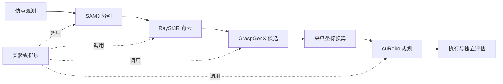

# 模块接口与扩展指南

模块负责自己的算法和参数，编排层负责安排调用顺序。共享层管理路径、通信与记录格式。模型按需加载，导入注册表不会加载其他模型或占用 GPU。

## 模块职责

| 层 | 负责内容 | 入口 |
| --- | --- | --- |
| 公共路径 | 工程根目录、权重目录、运行目录、历史元数据路径映射 | `arx_project/layout.py` |
| 公共接口 | Worker、Stage、StageOutcome | `arx_project/contracts.py` |
| 模块发现 | 按注册项加载一个模块 | `arx_project/registry.py` |
| 服务生命周期 | 启动、预热、健康检查、请求、退出 | `arx_project/service.py` |
| 处理顺序 | 检查输入、调用模块、检查输出、记录阶段结果 | `arx_project/pipeline.py` |
| 模型实现 | 分割、重建、抓取生成或规划 | 各模块的 `arx_adapter.py` |
| 实验管理 | 场景顺序、领取记录、资源门控、成功判定和停止条件 | `modules/pipeline/experiments/` |

相机投影与深度编码集中在 `modules/camera/`。GraspGenX 物理 TCP 与虚拟模型原点的换算集中在 `modules/graspgenx/arx_frames.py`。不同重建模型的实现分别放在自己的模块中，点云评测文件仅负责选择被测方法。

## 一个模块的接口

服务适配器提供 `create(args)`，返回具有 `request(directory, **options)` 方法的对象。`directory` 是当前观测或试验的目录，必须位于 `tmp/<method>/<run_id>/` 内。

| 模块 | 读取 | 产生 |
| --- | --- | --- |
| SAM3 | 头部 RGB、深度、相机参数、目标文字 | 预测掩码、校正后的图像与米制深度、分割回执 |
| RaySt3R | RGB、预测掩码、米制深度、内外参 | 相机系点云、世界系点云、重建回执 |
| GraspGenX | 世界系点云、夹爪条件描述、随机种子 | 原始模型抓姿、原生评分、分支来源、推理回执 |
| cuRobo | 实测机器人状态、场景碰撞信息、转换后的候选 | 规划结果、选中候选、路径或失败原因 |

长度统一使用米。深度 PNG 的量化比例写在相机参数中，模块不能根据文件名猜单位。世界系采用 Z 向上，相机采用 optical 坐标约定。

GraspGenX 输出为虚拟生成器坐标系在世界系下的位姿，不能直接当作实际 TCP。当前虚拟原点位于 EEF 后方 100 毫米，实际 TCP 位于 EEF 正 Z 方向 43 毫米；条件描述与输出换算必须成对使用。

每个模块保留自身的详细 JSON 回执。共享 RPC 用 `status=ok/error` 区分请求是否正常完成；模块结果中的 `success` 表示该阶段的结果。普通阶段失败停止当前处理链，资源、配置和记录故障抛给实验调度层处理。

## 替换一个模块

1. 在 `modules/<new_method>/` 放代码，在 `weights/<new_method>/` 放权重。
2. 实现 `create(args)` 和 `request()`；保持下游需要的输出文件、单位和坐标系，或者提供明确的转换适配器。
3. 在 `configs/modules.json` 登记代码入口、独立环境、权重和输入输出。
4. 在 `configs/pipelines/` 修改对应阶段的模块名。编排器通过注入的客户端调用模块。
5. 完成接口与故障检查，再为实际实验建立新的配置登记。

新增方法不需要修改其他模型的推理实现。模型库依赖保留在各自环境中，由本地服务协议跨环境连接。

## 现有执行入口

当前 200 场景执行器保留原有实验管理与物理评估，通过注册表取得各组件环境，并调用统一服务入口。旧 `services.py` 已缩减为兼容入口。

`configs/pipelines/sam3_graspgenx.json` 描述感知到候选的三个阶段；完整抓取的领取、执行与评估仍由原执行器负责。物理成功标准、故障停批和不自动重试的规则继续生效。
