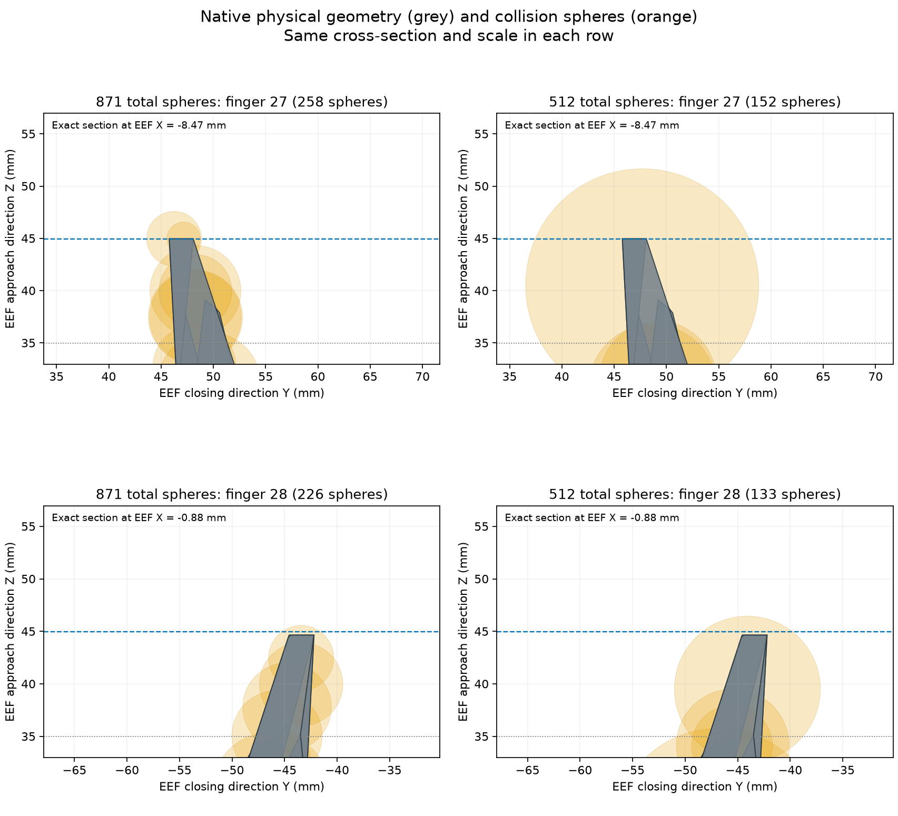

# V7 512球与871球的几何拟合精度核查

2026年11月27日。

**结论：当前这版512球不适合直接替换871球，指尖附近的额外膨胀太大。**

512球由871球在同一连杆内保守合并而来，合并后的大球完整包住原小球。这种做法保住原来的碰撞覆盖，但会把机器人外形变胖。当前最明显的损失出现在夹指前端，会把原本能伸进去的间隙判成碰撞。

## 指尖的精度差多少

取每根夹指最前端10毫米区域，测球模型外边界到PhysX实际凸碰撞体的向外距离。P95表示按外表面积加权后，95%的采样位置误差不超过该数值。“相对871新增外包”直接测512球外边界到871球包络的距离。

| 部位 | 871球外凸P95 | 512球外凸P95 | 相对871新增外包P95 | 新增外包采样最大值 |
| --- | ---: | ---: | ---: | ---: |
| 右臂夹指27 | 2.91毫米 | 9.02毫米 | 6.49毫米 | 7.33毫米 |
| 右臂夹指28 | 2.82毫米 | 5.18毫米 | 2.65毫米 | 3.07毫米 |
| 左臂夹指17 | 2.61毫米 | 7.81毫米 | 6.49毫米 | 7.33毫米 |
| 左臂夹指18 | 1.90毫米 | 3.55毫米 | 2.65毫米 | 3.07毫米 |

右臂第一根夹指的外凸P95从2.91毫米增加到9.02毫米，第二根从2.82增加到5.18毫米。512相对871的新增包络在两臂对应夹指上相同；实际物理碰撞体的分片不同，所以绝对拟合误差不同。

## 同位置截面对比

灰色是真实PhysX凸碰撞体截面，橙色是球模型截面。每行采用同一个截面、同一比例尺；蓝色虚线表示真实指尖平面，灰色点线标出其后10毫米。图中显示512球在第一根夹指前端明显鼓出。

沿末端接近轴的最前方外包距离，也从第一根夹指的3.00毫米增加到6.71毫米，第二根从1.60毫米增加到2.10毫米。新增外凸还有横向分量，不能只看最前方的一条轴。

## 手臂与整根夹指的拟合

下面以右臂为例，覆盖完整连杆外形；两臂对应的六段臂身具有相同的物理凸形状。

| 连杆 | 球数变化 | 871球外凸P95 | 512球外凸P95 | 相对871新增外包P95 | 新增外包采样最大值 |
| --- | ---: | ---: | ---: | ---: | ---: |
| right_link21 | 26→15 | 7.03毫米 | 12.34毫米 | 6.66毫米 | 8.82毫米 |
| right_link22 | 115→68 | 7.12毫米 | 12.82毫米 | 6.90毫米 | 9.43毫米 |
| right_link23 | 97→57 | 7.07毫米 | 13.32毫米 | 7.81毫米 | 11.62毫米 |
| right_link24 | 36→21 | 7.04毫米 | 13.44毫米 | 7.87毫米 | 9.91毫米 |
| right_link25 | 24→14 | 6.99毫米 | 11.19毫米 | 5.70毫米 | 7.23毫米 |
| right_link26 | 89→52 | 3.75毫米 | 8.48毫米 | 5.56毫米 | 7.51毫米 |
| right_link27 | 258→152 | 2.87毫米 | 5.99毫米 | 3.63毫米 | 7.32毫米 |
| right_link28 | 226→133 | 2.85毫米 | 5.13毫米 | 2.91毫米 | 5.10毫米 |

六段臂身的新增外包P95约为5.6～7.9毫米，采样最大约7.2～11.6毫米。空间宽松时这些误差可能不影响结果，但在桌沿、邻物和狭窄通道附近，会减少可用规划空间。

## 有没有因为减球漏掉真实物体

512球完整包住原871球，所有原球的覆盖关系均已独立核查。因此这次合并不会损失原871球已经覆盖的空间，主要代价是额外拦截。上一轮固定1280个关节状态中，512球相对871球新增拦截8个、没有新增放行，与这个几何结果一致。

本次对真实网格同时检查了表面漏包。右臂指尖在两种模型下均未发现漏包；右臂其他区域保留了原模型少数角点的小误差，512球没有新增漏包。

## 单独发现：左侧物理夹指与球模型的对齐

当前右侧每根夹指有19个物理凸碰撞片，左侧每根只有1个。左侧把整个夹指轮廓做成一个大凸包，填满了部分原来应为空的区域。两侧使用相同的球参数，因此左侧真实碰撞体表面存在原有漏包。

| 左侧部位 | 871球整根夹指漏包P95 | 512球整根夹指漏包P95 | 871球指尖区域漏包采样最大 |
| --- | ---: | ---: | ---: |
| left_link17 | 19.25毫米 | 17.65毫米 | 3.21毫米 |
| left_link18 | 19.21毫米 | 18.27毫米 | 4.24毫米 |

这是已有左右物理碰撞体划分不一致造成的问题。导出代码只对右侧两根夹指执行了分片，左侧沿用单个凸包。后续应单独统一左右夹指的物理分片，再按实际碰撞体复核球模型。

## 是否能接受

对于当前贴桌和拥挤场景，不能接受直接整套切换到这份512球。当前V2只允许指尖最前端10毫米与桌面上表面最多2毫米的局部接触；512球新增的约6.5毫米指尖P95膨胀已经超过这个尺度，邻物和夹指主体仍按原碰撞规则检查。

建议保留871球。后续若继续减球，应重新对实际碰撞体做带误差上限的拟合，优先保住指尖、指腹和狭缝侧面的精度。可以先比较“484个夹指球保持，只压缩387个臂身球”，逐段限制外包误差，再测试规划收益；不把512作为必须达到的数量目标。

## 测量与核验

使用当前URDF的网格、缩放与局部变换，由SAPIEN/PhysX在CPU上直接烘焙凸碰撞体。没有创建场景、渲染器或机械臂动作。原始网格凸包测量保留在01批次，正式结论采用实际烘焙几何的02批次。

每个连杆采样16384个网格表面点，每球1024个方向加六个轴向极点；四根夹指再将网格点和球面方向加倍。球面只保留未被其他球遮住的外露部分，距离统计按表面积加权。分别测真实表面未覆盖距离、球包络外凸距离和相对871的新增包络。

加倍采样后，指尖新增包络P95最大变化为0.039毫米，采样最大值最大变化为0.050毫米。24个最外凸点使用遍历全部三角面的独立距离算法复核，与空间索引查询一致。原球覆盖、实际烘焙源文件和默认871配置的散列核验通过，8项几何检查通过。

| 项目 | 结果 |
| --- | --- |
| 任务结果 | 左右共16个连杆核查，4根夹指加密核查完成 |
| 记录完整性 | 原始模型、物理网格、烘焙几何、采样数组、误差分布与图完整 |
| 事件适用性 | CPU几何比较；新增规划、仿真场景和物理抓取均为0 |
| 关键事件覆盖 | 原球全覆盖、实际凸片差异、外凸与漏包、指尖区域、采样稳定性、独立距离核验 |
| 当前配置 | 仍为871球，机器人和场景配置未变 |

正式结果：`tmp/sphere_count_diagnosis/geometry_fit_20261127_02`。
