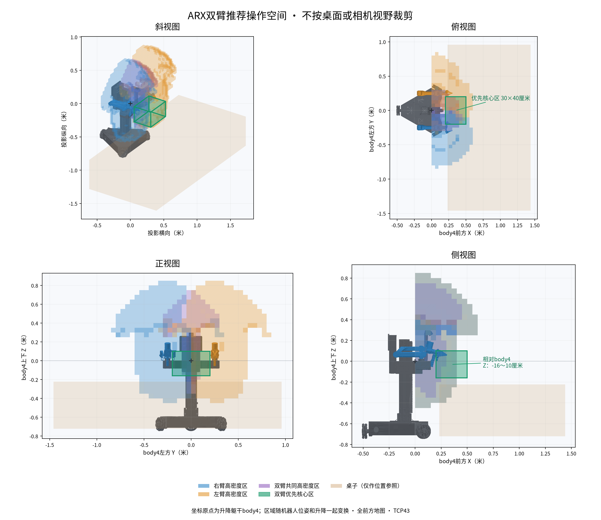

# 无桌面约束的双臂推荐操作空间

2026年11月25日。

这版用机器人自身的运动学地图选区，桌子保留在图中作为位置参照。选区使用机身坐标，不按当前桌高、桌沿或头部相机视野裁剪。

## 新图

蓝色为右臂高密度区，橙色为左臂高密度区，紫色为两臂共同高密度区。彩色区域统计整个前方空间，取5厘米位置格中关节配置采样数最高的四分之一。绿色框是另外选出的双臂共同优先核心区。

图中的机器人使用实际URDF视觉网格。显示姿态沿用升降45.2厘米、桌高50厘米，便于与[原来的桌面推荐图](../recommended_workspace/推荐操作空间.md)比较。新图的全部坐标以随升降运动的躯干`body4`为原点：X向前、Y向左、Z向上。

| 斜视 | 俯视 | 正视 | 侧视 |
| --- | --- | --- | --- |
| [打开斜视图](resources/斜视图.png) | [打开俯视图](resources/俯视图.png) | [打开正视图](resources/正视图.png) | [打开侧视图](resources/侧视图.png) |

## 推荐区域在哪里

下面均为TCP43相对`body4`的坐标，单位为厘米。三块参考矩形分别按各自的覆盖条件选取。

| 用途 | 前后X | 左右Y | 上下Z | 推荐中心 | 尺寸 |
| --- | --- | --- | --- | --- | --- |
| 双臂共同优先核心区，图中绿色框 | 20～50 | −20～＋20 | −16～＋10 | 前方35、居中、向下3 | 30×40×26 |
| 右臂优先参考区 | 20～46 | −56～＋6 | −34～＋24 | 前方33、向右25、向下5 | 26×62×58 |
| 左臂优先参考区 | 20～46 | −6～＋56 | −34～＋24 | 前方33、向左25、向下5 | 26×62×58 |

以后需要保留左右臂选择余地时，可以先把目标抓取点安排到绿色框附近。目标偏在某一侧时，可以使用对应手臂的参考中心生成底盘站位候选。

## 这次如何选区

复用已经冻结的前方运动学地图：原关节限位、TCP43及10559134条前方FK见证保持。左右臂采用经完整模型核对的50厘米肩部平移关系。

选区按2厘米格统计。每个格、每条相关手臂至少满足：29个已采样关节配置、26个已观测完整朝向格，以及4个下探朝向格。29和26分别来自整张前方地图对应统计量的下四分位数；下探指接近轴与机身竖直向下夹角小于60°。

本次把`body4`前方20厘米设为参考操作区的起点，给近身折叠区与前方操作区留出区分。这是工作区选取参数，地图中的近身采样仍完整保留。共同区围绕机身中线，单臂区围绕各自肩部，在上述条件下搜索体积最大的完整矩形。桌子尺寸、摆放、桌高和相机内参均不参与搜索。

| 核对项 | 双臂共同核心区 | 右臂参考区 | 左臂参考区 |
| --- | ---: | ---: | ---: |
| 2厘米位置格数 | 3900 | 11687 | 11687 |
| 体积 | 31.20升 | 93.50升 | 93.50升 |
| 每格平均关节配置数 | 右95.26／左94.58 | 122.42 | 122.42 |
| 每格完整朝向格数中位数 | 右57／左56 | 74 | 74 |
| 每格下探朝向格数中位数 | 22 | 28 | 28 |
| 每格下探朝向格数最小值 | 4 | 4 | 4 |

参考框用于挑选站位初值。后续将实际抓姿转换到机身系，再检查该抓姿的位置与朝向、关节解、机器人和环境碰撞，以及完整轨迹。

## 怎样用于自主调节升降

完整URDF的三个升降位置核对得到：在当前底盘内部关节设置下，`body4`相对底盘`base_link`的高度为：

**躯干高度 = 27厘米 ＋ 升降关节位置。**

升降关节范围为0～46厘米。因此，设目标TCP相对底盘原点的高度为H，希望它在机身系中的高度为z，则：

**升降位置 = H − 27厘米 − z。**

以共同核心区为例，z在−16至＋10厘米之间。对应可选升降区间为：

**H − 37厘米 ～ H − 11厘米，再与0～46厘米的关节范围取交集。**

| 目标TCP高于底盘原点 | 落入共同核心区的升降范围 | 对齐核心中心所需升降 |
| --- | --- | --- |
| 50厘米 | 13～39厘米 | 26厘米 |
| 60厘米 | 23～46厘米 | 36厘米 |
| 75厘米 | 38～46厘米 | 中心对齐需51厘米，可在关节范围内使用核心区较高部分 |
| 90厘米 | 本共同参考框内无可选值 | 继续查询单臂区和完整地图的其他位置与朝向 |

表中的H描述目标TCP高度。实际抓取时，先由GraspGenX得到抓姿，再用该TCP的高度换算。

## 怎样用于底盘前后、左右和转向

当前安装关系中，`body4`相对底盘原点向前约9.41厘米，向左约0.10厘米。因此，共同核心中心对应底盘前方约44.4厘米、机身中线附近。

一个直接的站位初始化流程是：

1. 从观测得到目标抓姿及目标TCP的世界位置。
2. 根据目标高度，用上面的公式产生升降候选。
3. 枚举底盘朝向，把参考中心变换到该朝向；让目标TCP落在这个中心附近，反算底盘XY位置。
4. 对候选站位运行V3的左右臂检查，比较实际抓姿能否解出、底盘及机械臂碰撞、完整路径和移动代价。
5. 到选定站位、升降停稳后，重新采集头部RGB-D，更新分割、点云和抓姿，再执行抓取。

对于某个底盘朝向，世界坐标下的计算关系是：**底盘XY = 目标TCP世界XY − 旋转后的“底盘到body4的偏移＋参考TCP机身坐标”的XY分量。**

转向后整片区域随机器人旋转，升降后整片区域随躯干上下移动。程序应使用当时的完整`T_base_body4`做变换；本次保存了三个升降位置的实际变换矩阵。

## 文件与原图保护

- [参考区域、统计及升降关系JSON](resources/参考区域与升降关系.json)。
- 选区程序：`modules/pipeline/experiments/bimanual_workspace_comparison/intrinsic_workspace.py`。
- 绘图程序：同目录`draw_intrinsic_workspace.py`。
- 原始计算与核验：`tmp/reachability/intrinsic_workspace_20261125_01/`。
- 本页图片为同目录`resources/`内的独立副本。

原来的桌面推荐图、四张单独视图、说明和绘图程序均保留，文件散列在本次结束时逐项复核。此次新增机器人动作、IK请求和抓取试验均为0。
