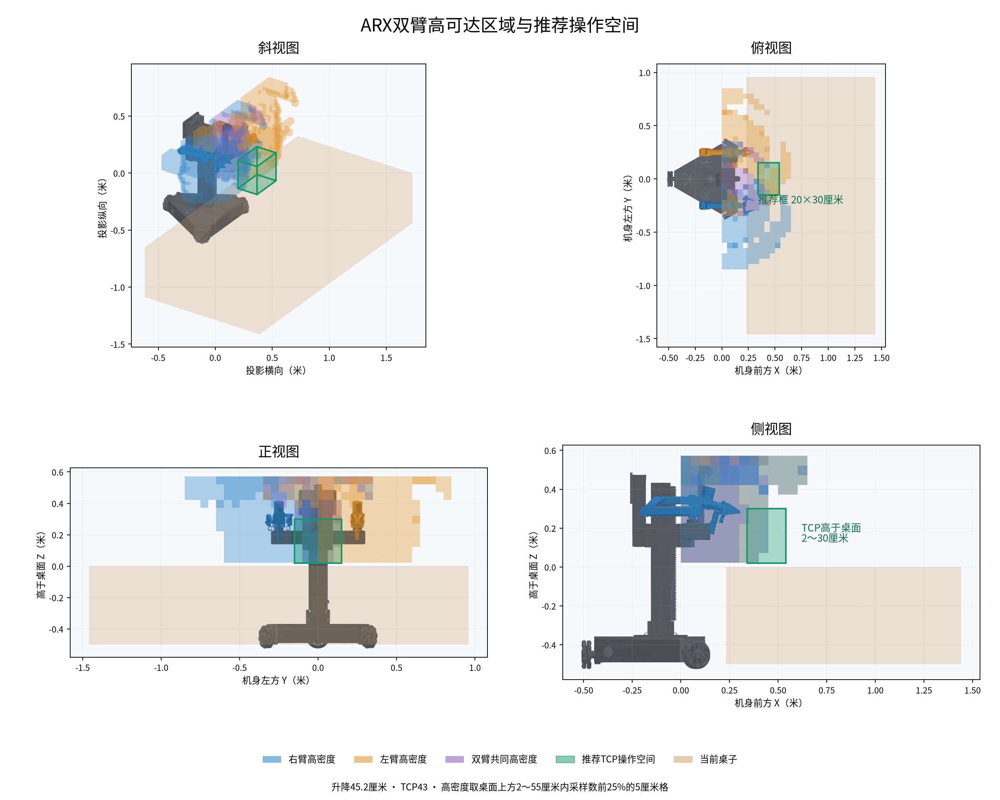

# 推荐操作空间与双臂多视角示意

2026年11月25日。

当前机器人升降固定45.2厘米、桌高50厘米、TCP43、头部相机向下45°时，建议优先在机器人正前方的 **20厘米×30厘米** 桌面区域操作，TCP高度范围为桌面上方 **2至30厘米**。

## 实际摆放时怎么量

| 参考方式 | 推荐范围 |
| --- | --- |
| 从底盘base_link原点向前量 | 约43.4至63.4厘米 |
| 相对机身中心线的左右范围 | 左右各约15厘米 |
| 从当前近侧桌沿向桌内量 | 约10.9至30.9厘米 |
| TCP高于桌面的范围 | 2至30厘米 |
| 推荐水平中心 | 底盘前方约53.4厘米，机身中心线附近 |

摆放物体时，优先让预计抓取部位的水平投影位于这个区域，预抓取和抬升继续使用上方空间。表中的三维范围描述TCP的位置。

## 多视角示意图

蓝色为右臂高密度区域，橙色为左臂高密度区域，紫色为两臂共同高密度区域，绿色线框为推荐TCP操作空间，棕色为当前桌子。

机器人使用当前完整URDF的真实视觉网格和初始关节状态。高密度区域取桌面上方2至55厘米内、采样配置数处于前25%的5厘米位置格。绿色框结合了双臂覆盖、桌沿位置和相机投影。

| 斜视 | 俯视 |
| --- | --- |
| [查看斜视图](resources/斜视图.png) | [查看俯视图](resources/俯视图.png) |

| 正视 | 侧视 |
| --- | --- |
| [查看正视图](resources/正视图.png) | [查看侧视图](resources/侧视图.png) |

## 程序使用的精确坐标

X、Y采用body4坐标系，X向机器人前方、Y向左。当前body4原点在桌面上方约22.2厘米。

| 坐标 | 下界 | 上界 |
| --- | ---: | ---: |
| body4 X | 0.340米 | 0.540米 |
| body4 Y | −0.150米 | ＋0.150米 |
| body4 Z | −0.202米 | ＋0.078米 |
| 当前仿真世界X | −0.616米 | −0.416米 |
| 当前仿真世界Y | ＋0.101米 | ＋0.401米 |
| 当前仿真世界Z | ＋0.020米 | ＋0.300米 |

当前仿真世界的桌面Z为0。body4和底盘原点在前后方向相差约9.4厘米，因此两种参考方式的前方距离不同。

## 如何选出这块空间

原地图最密集的一部分位于近身位置。选取桌面操作区时，还需要让区域落在桌沿内，并让头部相机能看到目标。

本次固定左右各15厘米、桌面上方2至30厘米的操作范围，沿前后方向按2厘米搜索。选区参考条件为近边距桌沿至少8厘米、投影角点距图像边缘至少30像素、每个位置格两臂均有覆盖，且每条臂至少有4个已观测到的向下朝向格。向下朝向采用原地图的定义，接近轴与竖直向下夹角在60°以内。

按当前桌子与相机几何，前界34厘米是第一个满足视野要求的搜索位置。后界54厘米是满足上述朝向参考条件的最远搜索边界。相机检查包括桌面支撑平面，最小投影边距约38.7像素。

## 地图核对结果

| 核对项 | 结果 |
| --- | --- |
| 推荐空间内的2厘米位置格 | 2100个 |
| 同时具有左右臂覆盖的位置格 | 2100个，占100% |
| 每格每条臂的向下朝向格数 | 最少4个 |
| 每格取两臂较小值后的向下朝向格数中位数 | 15个 |
| 右臂每格平均配置样本数 | 58.18个 |
| 左臂每格平均配置样本数 | 57.67个 |

这里给出的是基于已观测运动学覆盖的推荐位置范围。具体抓取位姿按现有链路检查位置、朝向、限位、桌面和邻物碰撞，以及完整运动路径。

## 文件

- 选区程序为`modules/pipeline/experiments/bimanual_workspace_comparison/recommend_workspace.py`。
- 绘图程序为同目录`draw_workspace.py`。
- 机器可读坐标、搜索记录和图像来源位于`tmp/reachability/recommended_workspace_20261125_01/`，主文件为`workspace.json`。
- 本文图片为同目录`resources/`中的独立副本。
